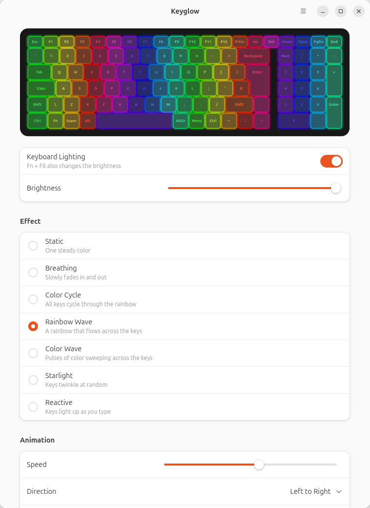

# Keyglow

**SteelSeries GG alternative for Linux.** Keyglow controls the per-key RGB keyboard backlight of MSI laptops, and rebrands such as Monster, that use a **SteelSeries KLC** keyboard controller.



- A GNOME app (GTK 4 + libadwaita) with a live, animated keyboard preview
- Seven effects: Static, Breathing, Color Cycle, Rainbow Wave, Color Wave, Starlight and Reactive (keys light up as you type)
- Color, brightness, speed, wave direction and wave size controls
- **Effects run on the keyboard controller itself.** Once set, nothing keeps running on your computer, and animations stay smooth even when the app is closed.
- Keeps your lighting: restores it at boot (before you log in), at every login and after suspend
- A `keyglow` command for the terminal and scripts

## Does it work on my laptop?

Keyglow works with the SteelSeries KLC controller, not with external SteelSeries keyboards (OpenRGB already supports those). Check for the controller with:

```bash
lsusb | grep -iE "1038:(113a|1122)"
```

| USB id | Controller | Status |
|---|---|---|
| `1038:113a` | SteelSeries KLC | Tested on a Monster Semruk S7 V9.1 |
| `1038:1122` | SteelSeries KLC (older MSI models) | Same protocol, untested |

If the line shows up, Keyglow should work. Please [open an issue](https://github.com/beylerburak/keyglow/issues) either way to say which laptop you tried, so this list can grow.

The light bar and logo LEDs on the case (SteelSeries ALC) are not supported.

## Install

Keyglow needs Ubuntu 24.04 or newer, Debian 13 or newer, or another distribution with libadwaita 1.5.

**From the terminal** (downloads the latest release and installs it with apt):

```bash
curl -fsSL https://raw.githubusercontent.com/beylerburak/keyglow/main/install.sh | bash
```

**As a package:** download `keyglow_<version>_all.deb` from [Releases](https://github.com/beylerburak/keyglow/releases), then:

```bash
sudo apt install ./keyglow_0.1.0_all.deb
```

**From source:**

```bash
git clone https://github.com/beylerburak/keyglow.git
cd keyglow
./install.sh
```

Then open **Keyglow** from the app menu. To remove it, run `sudo apt remove keyglow`. Your settings stay in `~/.config/keyglow`.

## Command line

```bash
keyglow status                                  # keyboard and current settings
keyglow effects                                 # list effects
keyglow set static --color ff8000
keyglow set rainbow --speed 70 --direction left
keyglow set reactive --color 000000 --highlight ffffff
keyglow off
keyglow on
```

`Fn` + `F8` still changes the hardware brightness and turns the backlight off. If the keyboard stays dark, press it a few times.

## How it works

The controller is a USB HID device. Keyglow writes to its `hidraw` node directly and needs no extra drivers:

- `0x0e` packets set color and mode for up to 42 keys at a time.
- `0x0b` packets define an animation: a start color plus up to 16 timed color transitions, optionally shifted across the keyboard as a wave. The controller plays it on its own. One time unit is 10 ms.
- A `0x09` packet latches everything.

A udev rule (`70-keyglow.rules`) gives the logged-in user access to the controller without root. Your lighting is restored by:

- `keyglow-restore.service` (system): runs when the controller appears at boot and after resume, and applies the most recently saved settings of any user.
- `keyglow.service` (user): runs at every graphical login.

The protocol comes from [msi-perkeyrgb](https://github.com/Askannz/msi-perkeyrgb) (Askannz, TauAkiou), [OpenRGB](https://gitlab.com/CalcProgrammer1/OpenRGB) and captures of SteelSeries Engine presets.

## Development

```bash
bin/keyglow gui                                 # run from the source tree
python3 -m unittest discover -s tests -t .      # tests, no keyboard needed
packaging/build-deb.sh                          # build dist/keyglow_<version>_all.deb
```

| Path | What it does |
|---|---|
| `keyglow/protocol.py` | Packet encoding |
| `keyglow/device.py` | Finds the controller and sends packets |
| `keyglow/effects.py` | Turns settings into effects; simulates them for the preview |
| `keyglow/layout.py` | Key positions of the 17" ISO keyboard |
| `keyglow/app.py`, `keyglow/preview.py` | The GTK app |
| `keyglow/cli.py` | The `keyglow` command |
| `packaging/` | `.deb` build script and install hooks |

Pushing a `v*` tag builds the `.deb` and attaches it to a GitHub release.

## Author

Made by [@beylerburak](https://github.com/beylerburak).

## License

GPL-3.0-or-later. See [LICENSE](LICENSE).
